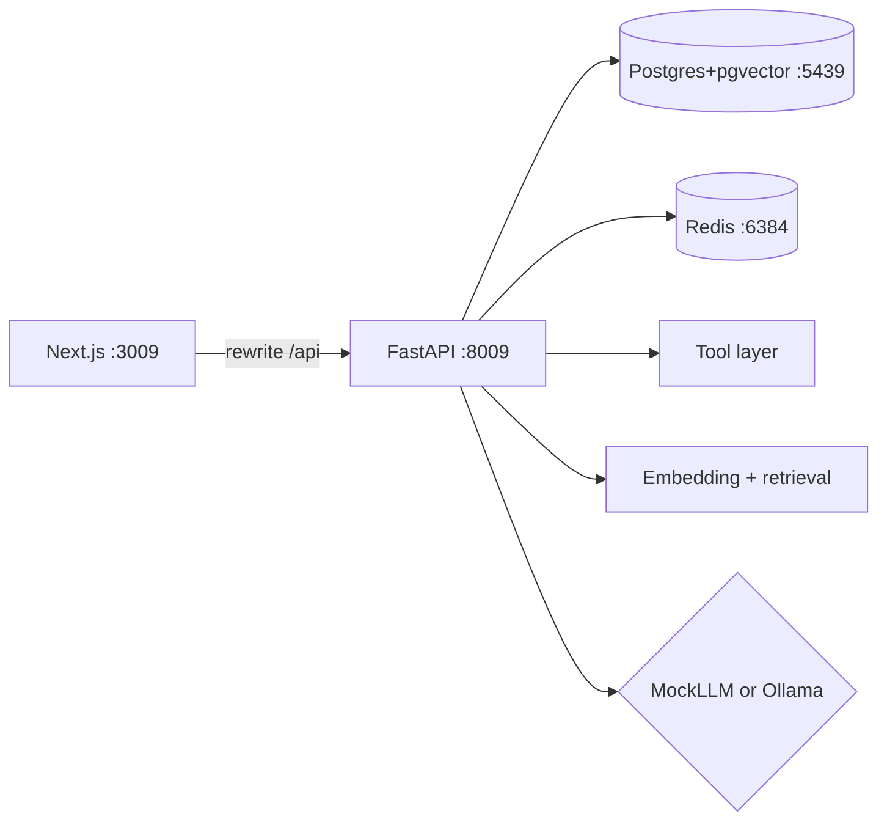

# RootCause — AI Debugging Assistant

## Overview

RootCause is an evidence-bound AI software debugging and root-cause assistant. It is **not** a chatbot toy: every important conclusion must cite retrieved evidence from tools and RAG.

## Architecture

Yarn Workspaces + Turborepo monorepo. Python/FastAPI hosts auth, investigations, RAG, tools, and the LLM provider (NestJS is intentionally not used). AI stays inside `apps/api` — the investigation pipeline is one FastAPI process, not a separate runtime.

```
apps/
  web/         # Next.js console (frontend only; /api proxied to FastAPI)
  api/         # FastAPI: auth + investigations + RAG + tools + LLM
infrastructure/
  docker-compose.yml   # Postgres (pgvector) + Redis
  docker/
packages/              # No Prisma; SQL migrations live with api
docs/
```



## Ports

| Service | Port |
| --- | --- |
| Next.js | 3009 |
| FastAPI | 8009 |
| Postgres (pgvector) | 5439 |
| Redis | 6384 |
| Ollama (optional) | 11434 |

## Quick start

```bash
cd 05-ai-debugging-assistant
cp apps/api/.env.example apps/api/.env
cp apps/web/.env.example apps/web/.env.local

yarn install
yarn python:install
yarn infra:up

yarn db:migrate
yarn db:seed

# terminals (or yarn dev for both):
yarn api:dev
yarn web:dev
```

- UI: http://localhost:3009
- API docs: http://localhost:8009/docs
- Demo: `admin@rootcause.local` / `Password123!`

## Scripts

| Command | Purpose |
| --- | --- |
| `yarn infra:up` | Start Postgres (pgvector) + Redis |
| `yarn python:install` | Create API venv + install deps |
| `yarn db:migrate` / `yarn db:seed` | Schema + seed data |
| `yarn dev` | Web + API |
| `yarn test` | API unit/integration (pytest) |
| `yarn eval` | Evaluation harness (`scripts/eval.py`) |
| `yarn build` | Build workspaces (web Next.js) |
| `yarn lint` / `yarn typecheck` | Frontend quality gates |

## LLM providers

```bash
# Default for CI / no GPU
LLM_PROVIDER=mock

# Optional local model via Ollama
LLM_PROVIDER=ollama
OLLAMA_BASE_URL=http://localhost:11434
OLLAMA_MODEL=qwen2.5:7b
```

**No paid AI APIs.** If Ollama is down, the API falls back to MockLLM automatically.

## Tools

- `search_logs()`
- `get_metrics()`
- `get_recent_deployments()`
- `get_service_dependencies()`
- `search_previous_incidents()`
- `search_runbooks()`

## Package manager

**Yarn only** (`yarn.lock`). Do not use npm or pnpm for this repo.

## Docs

See `docs/` for PRD, architecture, API, evaluation, security, and `docs/completion-report.md`.
