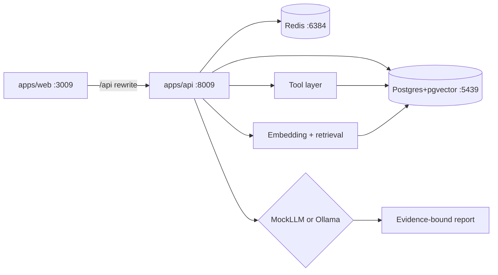

# RootCause — Architecture

## Monorepo layout

```
05-ai-debugging-assistant/
├── apps/
│   ├── web/          # Next.js + React (frontend only)
│   └── api/          # FastAPI: auth + investigations + RAG + tools + LLM
├── packages/         # Reserved; SQL migrations live under apps/api (no Prisma)
├── infrastructure/   # Docker Compose: Postgres (pgvector) + Redis
├── docs/
├── package.json      # Yarn Workspaces root
├── yarn.lock
└── turbo.json
```

### Why AI stays in `apps/api` (no `apps/ai`)

The product investigation loop — tools → evidence → RAG → LLM → structured report — already runs as a single FastAPI request pipeline (`app/services/investigation.py` plus `app/tools`, `app/rag`, `app/llm`). Splitting a separate `apps/ai` process would be an artificial boundary with no independent deployable workload today. Auth, persistence, and the AI pipeline share one process and one database. Prefer honesty over fake boundaries; introduce `apps/ai` only if a distinct long-running AI runtime appears later.

## High-Level



## Components

### FastAPI (`apps/api`)
- Auth (JWT), investigations CRUD, health
- Tool registry: logs, metrics, deploys, deps, incidents, runbooks
- RAG over pgvector (`document_chunks.embedding vector(384)`)
- LLM providers: MockLLM (default) or optional Ollama — **no paid APIs**
- Why FastAPI: RAG, embeddings, and tool-calling fit Python better here than NestJS

### Next.js UI (`apps/web`)
- Login, investigation console, report views
- Same-origin `/api/*` rewrite to FastAPI — no Next.js Route Handlers as backend

### PostgreSQL + pgvector
- Port **5439**; databases `rootcause` / `rootcause_test` only
- SQL migrations via `apps/api/scripts/migrate.py`

### Redis
- Port **6384**; optional cache for tool/RAG lookups

## Investigation pipeline

1. Persist investigation row (`queued` → `running`)
2. Collect evidence via tools (logs, metrics, deploys, deps, incidents, runbooks)
3. Deduplicate / rank evidence
4. Call LLM provider with symptom + evidence only
5. Sanitize evidence IDs
6. Persist structured report (`completed`)

## RAG

Documents and telemetry snippets are chunked, embedded with a deterministic local hasher, and stored in `document_chunks.embedding vector(384)`. Retrieval uses cosine distance (`<=>`).

## Why MockLLM default

Ollama may be absent in CI. MockLLM still runs the full RAG+tool pipeline and pattern-matches controlled signatures using **only** retrieved evidence IDs.
