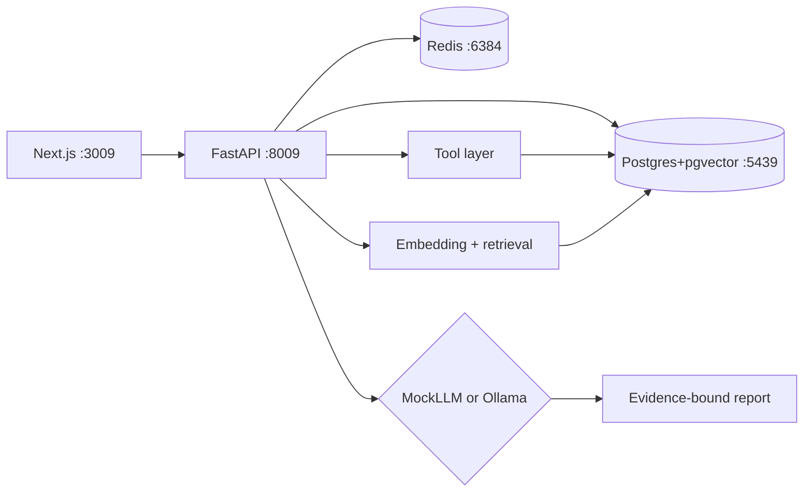

# Architecture

## Investigation pipeline

1. Persist investigation row (`queued` → `running`)
2. Collect evidence via tools (logs, metrics, deploys, deps, incidents, runbooks)
3. Deduplicate / rank evidence
4. Call LLM provider with symptom + evidence only
5. Sanitize evidence IDs
6. Persist structured report (`completed`)

## RAG

Documents and telemetry snippets are chunked, embedded with a deterministic local hasher, and stored in `document_chunks.embedding vector(384)`. Retrieval uses cosine distance (`<=>`).

## Why MockLLM default

Ollama may be absent in CI. MockLLM still runs the full RAG+tool pipeline and pattern-matches controlled signatures using **only** retrieved evidence IDs.
